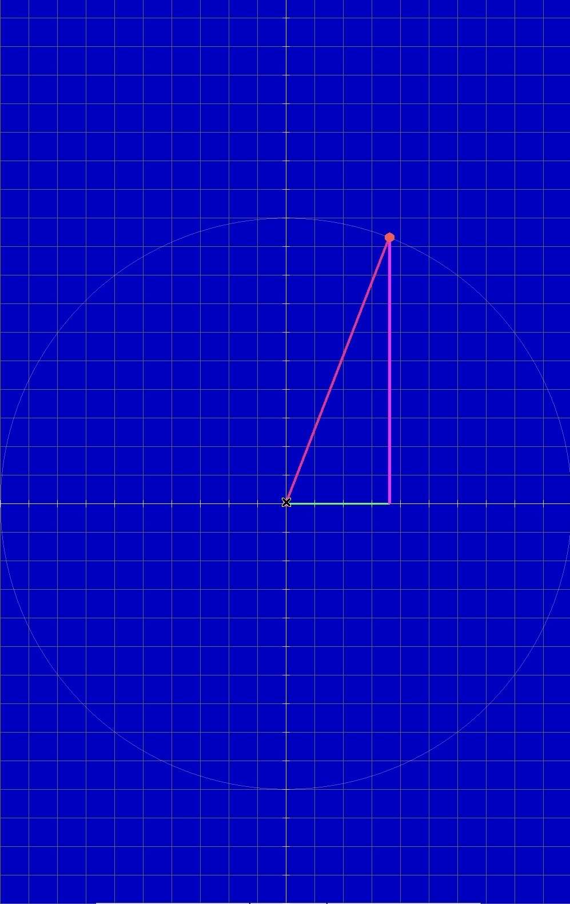

<h2>🔺 Radian Geometry — C++ & SDL2</h2>

  <strong>Visualizing Angles, Circles, and Right Triangles</strong>

  A small graphical experiment built with C++ and SDL2.

---

<h2>📌 About the Project</h2>Radian Geometry is a small personal project created during my free time using C++, SDL2, and SDL2_gfx.

The program takes an angle in radians, calculates a point on an imaginary circle, and draws a right triangle on a coordinate plane.

This is the first version of the project. I may add more interesting mathematical visualizations and features in the future to make it more useful and interactive.

---

<h2>🖼️ Preview</h2>

  

  <em>A circle, coordinate axes, and a right triangle generated from an angle in radians.</em>

---

<h2>✨ Features</h2>- 📐 Takes an angle in radians as input.
- 🔵 Draws a circle on a coordinate plane.
- 🟩 Draws the horizontal side of the triangle.
- 🟨 Draws the vertical side of the triangle.
- 🟠 Draws the hypotenuse.
- 🔴 Highlights the point on the circumference and the origin.
- 📊 Displays a coordinate grid, X and Y axes, and tick marks.
- 🖥️ Renders graphics using SDL2 through Termux:X11.

<h2>📐 Mathematical Background</h2>
Given a circle with radius <i>r</i> and an angle <i>θ</i> in radians, the coordinates of the point on the circle are:

  

  

In this project, the radius is:

  

The right triangle's side lengths are:

  

  

  

<h2>🛠️ Built With</h2>Technology| Purpose
C++| Core logic and mathematical calculations
SDL2| Window management, rendering, and events
SDL2_gfx| Circle and thick-line drawing
Termux| Development and compilation
Termux:X11| Graphical display

---

<h2>📦 Requirements</h2>Make sure you have the following installed:

- Android with Termux.
- Termux:X11 and a working graphical session.
- A C++ compiler.
- SDL2 development libraries.
- SDL2_gfx development libraries.

<h3>📥 Install Dependencies</h3>Run the following commands in Termux:

pkg update
pkg install clang sdl2 sdl2-gfx

<b>Note:</b> Termux:X11 must also be installed and configured separately.

---

<h2>🚀 Getting Started</h2><h3>1️⃣ Clone the Repository</h3>git clone <YOUR_REPOSITORY_URL>
cd <YOUR_REPOSITORY_DIRECTORY>

Replace the placeholders with your actual repository URL and directory name.

<h3>2️⃣ Make the Script Executable</h3>chmod +x run.sh

<h3>3️⃣ Open Termux:X11</h3>Start the Termux:X11 graphical application and make sure the display is available.

<h3>4️⃣ Run the Program</h3>./run.sh

The script compiles "test.cpp" and runs the resulting executable automatically.

<b>You do not need to compile the program manually.</b>

<h3>5️⃣ Enter an Angle</h3>When prompted, enter an angle in radians:

Enter angle in radians: 1.5708

The graphical output will appear in the Termux:X11 environment.

<b>⚠️ Note:</b> The current version accepts one angle per launch. Run "./run.sh" again to visualize another angle.

---

<h2>📁 Project Structure</h2>.
├── test.cpp
├── run.sh
└── images/
    └── tr1.jpg

- "test.cpp" — Main C++ source code.
- "run.sh" — Compilation and execution script.
- "images/tr1.jpg" — Project screenshot.

---

<h2>⚙️ How It Works</h2>1. The program reads an angle in radians from the terminal.
2. It calculates the point's coordinates using "sin()" and "cos()".
3. SDL2 initializes the window and renderer.
4. The program draws the grid, axes, circle, triangle, and reference points.
5. The rendering loop keeps the window open until the user closes it or presses "Esc".

---

<h2>🔮 Future Improvements</h2>This is just the first version, and there is plenty of room for improvement.

Possible future features include:

- 🎚️ Changing the angle without restarting the program.
- 📍 Displaying the point's coordinates.
- 📏 Showing the triangle's side lengths.
- 🔄 Animating the point as the angle changes.
- 📈 Visualizing sine and cosine.
- 🧭 Displaying the angle's quadrant.
- 🎨 Improving the graphical interface.

<blockquote>
  <strong>These are ideas for future development, not features currently implemented.</strong>
</blockquote>---

<h2>👨‍💻 Development Notes</h2>This project was developed in Termux on Android, with graphical output displayed through Termux:X11.

It started as a free-time experiment combining trigonometry, coordinate geometry, and graphical programming.

The project is still in its early stages, and I may continue improving it over time.

---

  <strong>📐 A little math, a little C++, and a circle full of possibilities.</strong>

